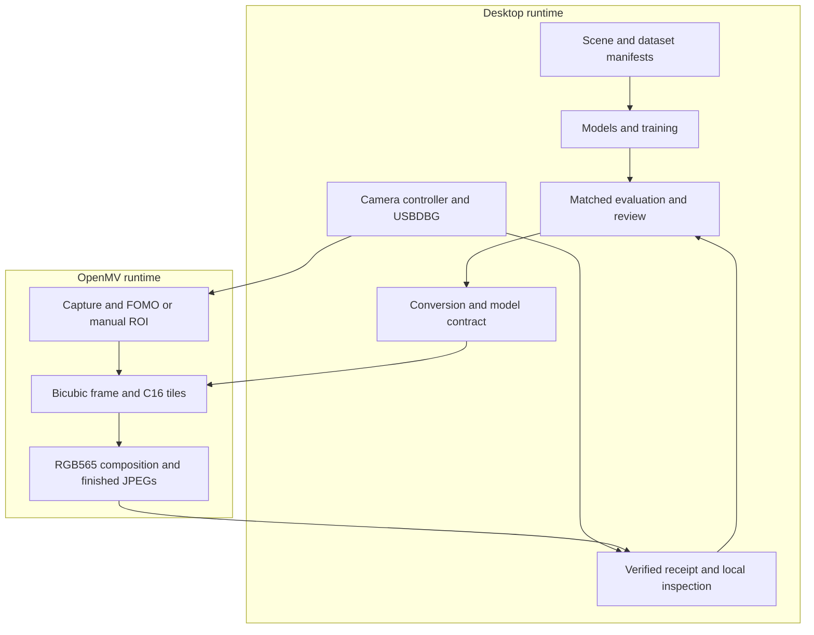

# Architecture

The desktop package has one command dispatcher. Numerical modules and camera dependencies are imported on demand. Model files and metadata are separate from architecture code; the registry binds exact baseline identities. The device runtime sources live under `src/tinysr/device/openmv/` so a packaged installation can assemble the same files as a checkout.

`common/geometry.py` supplies half-open source-coordinate rectangles and exact-cover valid tiles. The assembler includes that dependency-light source directly in the device namespace. Device-specific image buffers, FOMO decoding, ML callbacks and RGB565 writing remain camera implementations; desktop NumPy composition has numerical parity tests rather than pretending both runtimes use identical image APIs.

The assembler emits constants, shared geometry, transport, detection, SR functions and the application entry point. Generated source remains local. It is not edited or committed as a competing implementation. The device receives one temporary USBDBG program and does not overwrite boot files.

The host collector validates sizes, ordering, checksums and completion before exposing artifacts. A transport error is not a completed image or a detector-negative result. Raw diagnostics stay local. Public exports are constructed from allowlisted fields, without recursively copying whole run directories.

Heavy datasets and outputs live under ignored `work/` or external roots. Model weights are immutable artifacts; changing a checkpoint creates a new experiment rather than replacing a baseline silently. CPU inference and explicitly requested CPU training support machines without CUDA; explicit CUDA requests fail when unavailable.
